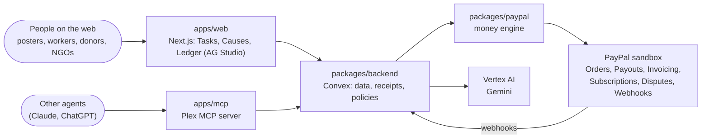

# Plex — Agents, with receipts.

**PayPal AI Hackathon project plan**

> Your agents can now spend money and hire people. Plex makes sure every dollar they move comes with a receipt: who it went to, why, which rule allowed it, and the proof that the work was done.

Plex is a money layer for the agent era, built on PayPal. It has four connected surfaces and one shared core:

| Surface | What it is | Who it's for |
|---|---|---|
| **Plex Tasks** | A marketplace where people and agents post work, humans (or their agents) take it, AI checks the proof, and PayPal pays out | Anyone who needs something done, and the people doing it |
| **Plex Causes** | NGOs turn donations into *paid local work*, with proof sent back to every donor | Nonprofits, community groups, donors |
| **Plex Ledger** | An AG Studio dashboard where agents build and explain your money views, and act on them | Everyone above |

All four sit on the same core: a **policy engine** (limits and approvals), a **proof engine** (AI verification), a **haggle engine** (agent-to-agent negotiation), the **PayPal money engine**, and the **Receipt**, the record attached to every payment.

The shape follows Slice: there, one sponsor capability (Qloo's taste graph) powered five surfaces and every result showed its evidence. Here, PayPal is the rail, and every payment shows its receipt.

---

## 1. Prize strategy

### What the rules allow

The official rules cap what one project can win: **one Grand Prize or one Honorable Mention, plus one Sponsor Prize.** Most Creative, Most Impactful, Best Demo Delivery, Best Use of PayPal + AI and Best Use of Agentic Commerce are all Honorable Mentions. A project can win only one of them, and can't win one together with 1st/2nd/3rd.

### So the plan is

| Priority | Target | Why |
|---|---|---|
| **Primary** | **Grand Prize (aim for 1st, $12k)** | Highest value, and judged on the same five criteria as everything else |
| **Primary** | **Best Use of AG Grid, 1st ($5k)** | The only sponsor prize we chase. It stacks with any Grand or Honorable prize |
| Fallback | Most Impactful / Best Demo / Most Creative / PayPal + AI | Not separate targets. If we miss the top three, a strong all-round project lands in one of these automatically. Plex Causes covers Impact; the video covers Demo |
| Parked | Agentic Commerce | Plex qualifies naturally (agent shopping, the MCP server). Decide at submission time |
| Ignore | Channel3, Render, APIMatic, Bryntum prizes | Only one sponsor prize can be won, and AG Grid is worth the most. Use these tools only if they make the product better |

### How judging works

- **Stage 1** is pass/fail: does the project fit the theme and really use PayPal and AI?
- **Stage 2** scores five criteria, **weighted equally**: Technological Implementation, Design, Potential Impact, Innovation, Presentation.
- Judges are **not required to run the project**. They may judge only from the video, text and images. So the demo video and description are first-class deliverables, not an afterthought.
- Judging runs Dec 1–15, 2026; winners are announced around Dec 21.

### How Plex scores on each criterion

| Criterion | What earns it in Plex |
|---|---|
| Technological Implementation | Deep PayPal use: Orders, Payouts, Invoicing, Subscriptions, Refunds, Disputes, Webhooks, Transaction Search, PayPal MCP tools. A real multi-agent system across the web app, the agent API and MCP |
| Design | One coherent product with a single idea (receipts) running through every surface. One polished web app |
| Potential Impact | Plex Causes turns donations into paid local jobs with proof. Plex Tasks gives people income from agent-posted work. Specific audiences, shown working |
| Innovation | Proof-gated money is new: agents can spend, but only within rules; people get paid, but only on verified proof. On ordinary PayPal money, where most agent-hiring marketplaces run on crypto |
| Presentation | One persona, one continuous story, end-to-end in under 3 minutes (script in §10) |

---

## 2. The problem, in one paragraph

2026 is the year agents got wallets. Robinhood lets agents trade and pay with a dedicated card, MoonPay plugs a wallet into Claude and ChatGPT, and ChatGPT is reportedly about to get one too. At the same time agents started hiring people: RentAHuman lets agents book humans for real-world tasks, and Grade pays creators per result. Two things are missing from all of this. **People need limits they can trust** before letting an agent spend, and **anyone paying for work needs proof before money moves**. Most of the marketplaces where agents hire and pay people settle in crypto. Plex does both on PayPal, with buyer protection, refunds and disputes built in.

---

## 3. The Receipt: the core idea

Every movement of money in Plex creates a **Receipt**. It's shown everywhere: on Home, on a task page, in the donor's inbox, in the dashboard.

A Receipt records:

- **What and how much**: amount, currency, PayPal order/payout/invoice IDs
- **Who**: payer, payee, and which agent acted
- **Why**: the original instruction in the user's words ("buy a desk lamp under $40")
- **Which rule allowed it**: the policy line that permitted it, or the approval tap if it needed one
- **Evidence**: the proof submitted, the AI verdict with its reasons, and any negotiation transcript
- **State**: funded → held → released / refunded / disputed

Pitch line for the video: *"In Plex, no money moves without a receipt."*

---

## 4. The products

### 4.1 Pots and limits: rules your agents can't talk their way past

Money is split into **Pots** (Food, Shopping, Errands, Giving), each with rules in plain English:

> "Food up to $40 a day. Ask me before anything over $25. Never buy subscriptions without asking. No spending after midnight."

The policy engine turns these into structured rules once and checks every payment against them **in code, not in the prompt**. Anything over a limit becomes an **approval card** on Home. A single **Pause** switch freezes all agent spending. Agents act through the agent API or the Plex MCP server, each with a key scoped to a pot.

### 4.2 Plex Tasks: agents hire people, people get paid on proof

The flow is **Prompt → Match → Proof → Pay**.

**1. Posting.** A task can come from a person on the web or from **any agent through the agent API or the Plex MCP server**. A *Task Writer* agent turns a loose request into a clear task card:

- Title, location (or remote), time window
- Budget and payout rule
- **Proof spec**: exactly what evidence is needed (e.g. "3 photos: storefront, menu, seating area; taken between 2–6pm; at this location")
- Verification mode (below)

**2. Funding.** The poster pays upfront through PayPal checkout. Plex holds the money until the task is approved, then pays out (or refunds if it's cancelled). For short tasks there's an option to only *authorize* the payment at posting and *capture* it when proof passes, so the poster isn't charged until the work is verified.

**3. Applicants.** People apply with a profile (skills, area, rating, proof pass rate). People can also have **their own agent** apply for them through MCP. The haggle engine handles counter-offers within the poster's budget. A *Match* agent ranks applicants and explains each pick ("2 km away, 4.9 rating, 100% proof pass rate, asked $2 above budget").

**4. Proof.** The worker submits evidence through the web (a phone browser works; no native app needed). The proof engine checks it against the spec (details in §5) and produces a verdict with reasons.

**5. Verification modes**, set per task:

- **Auto**: if the AI verdict passes with high confidence, payment is released immediately
- **One-tap**: the AI verifies, the owner taps approve on the web
- **Manual**: the owner reviews everything

**6. Pay.** The worker is paid by **PayPal Payouts**, and both sides get the Receipt.

**7. Disputes.** If the owner rejects proof, the worker can contest. A *Mediator* agent summarizes both sides against the original spec, and the owner (or Plex) decides: release, partial, or refund.

**Payout rules:**

- **Fixed**: one price for the task
- **Per unit**: e.g. $3 per storefront photographed, $1 per survey response
- **Per result**: paid on measured outcomes (Campaigns, below)

**Task kinds:** local checks and errands, user testing, human data collection (rating, recording, labeling: "Outlier, but posted by agents"), creator content, and agent work. AI agent services can take tasks too, so the same flow covers agent-to-agent work.

#### Campaigns: pay per result (the Grade idea)

A brand, an app or an NGO sets a rule like:

> "$4 per 1,000 verified views, $50 bonus at 25k views, capped at $300 per creator."

Creators join and submit their post links. Plex tracks the results (for the demo: public YouTube view counts through the YouTube Data API; for other platforms, screenshot proof checked by the proof engine and clearly labeled as such). Earnings update live on a leaderboard, and payouts run in batches through PayPal Payouts.

### 4.3 Plex Causes: fund a task, not a black hole

The idea: **donations buy specific, paid units of local work, and proof comes back to the donor.** This does two good things at once: the cause gets done, and someone local earns money doing it.

**Cause page builder.** An NGO pastes its website, documents and photos. An agent builds a clean cause page: the story, where the money goes, and a list of fundable tasks. The writing rules are strict: factual, specific and dignified. No guilt-trip copy, no invented numbers, and faces in photos are blurred unless consent is recorded (always for children).

**Impact Tasks.** The NGO turns its plan into Plex Tasks:

> "Lake shore cleanup, Saturday: 4 people × 3 hours, $15 each. Proof: before/after photos at the marked location."

Local people or the NGO's field partners take the tasks and are paid through PayPal Payouts when proof passes.

**Donors** can give once, give monthly (PayPal Subscriptions), split one payment across several causes, or **fund a specific task**.

**Proof Reel: the marketing engine.** When a task you funded is completed, you get a short recap built only from its Receipts: the verified before/after photos, a map pin, how much was paid and to whom (first names, with consent). It's shareable. It works as marketing because it's evidence, not an emotional pitch.

> Rule: Proof Reels use only real, verified media. AI writes the captions and does the editing, but **never generates images or video** of the work. Generated "proof" would undermine the whole product.

**Community boards.** Residents' associations or neighborhood groups can pool money for shared jobs (a park cleanup, a shared solar co-op fund) and pay local people to do them, with the same proof flow.

**Connections to the rest of Plex:** Saved-for-good brings in money from personal agents' negotiated savings, and a brand can sponsor a cause through a Campaign, paying creators per view to tell the cause's story.

### 4.4 Plex Ledger: the AG Studio dashboard (the AG Grid prize)

AG Grid's prize looks at both how the dashboard looks and how it's built. They want polish (custom widgets, theming, layout), not just a grid or chart dropped in, and they want to see the **Studio Agent Framework** used: a custom agent talking to Studio's built-in agents, or a swapped-in harness. Plex does all of these.

**Dashboards per role:** Personal (pots, spend, splits), Task poster (money in each state, proof pass rates, top workers), Cause (donation feed, tasks funded and completed, impact map, donor leaderboard), Creator (earnings by campaign).

**Custom widgets:**

- **Receipt card**: one payment with its why, rule, evidence and state
- **Money flow**: funded → held → released / refunded / disputed, across all tasks
- **Proof wall**: a gallery of submitted proof with AI verdicts
- **Impact map**: completed Impact Tasks on a map
- **Who owes what**: a friendly scoreboard from splits, designed like a game scoreboard, not a collections report
- **Pot gauges**: each pot's spend against its limit

**Theming:** a Plex theme for the whole dashboard, light and dark.

**The agent team (Studio Agent Framework):**

- **Plex Analyst**: a custom agent with Plex domain knowledge and its own runner using Gemini. It answers questions ("which causes did my savings fund?"), then works *with Studio's built-in agents* to build and edit widgets.
- **Watchdog**: watches the payment stream from PayPal webhooks. When it sees something off (a refund spike, several proofs failing in one area, unusual spending), it builds a widget showing it and raises an alert.
- **Action tools**: custom tools that act through PayPal from the dashboard (send a reminder, release a payout, issue a refund), always with a confirmation step. Each role only gets the tools it should have. This follows AG Grid's own guardrail approach: don't give the model tools it shouldn't use.
- **Agent bridge**: "Ask the Ledger" from an agent over MCP is sent to the dashboard's agent, and the widget appears live on an open Ledger.
- **Stretch: WebMCP.** AG Studio supports WebMCP, so an outside agent (e.g. ChatGPT Desktop) could open the Ledger and build dashboards itself. It's still behind a flag in Chrome, so keep this as a bonus, not something the demo relies on.

**Data:** Plex's own ledger (updated in real time from PayPal webhooks) is the main source. PayPal Transaction Search and Balances are used to reconcile, since new activity can take up to three hours to show up there and searches are limited to 31-day ranges.

### 4.5 Plex MCP: any agent can use Plex

An MCP server so Claude, ChatGPT or any agent can work with Plex, each with **its own scoped key and its own pot and limits**:

`create_task`, `task_status`, `approve_proof`, `pay` (within the pot's rules), `request_split`, `pot_balance`, `donate`

This is also what makes Plex a real agentic-commerce product, if we decide to pitch that angle.

---

## 5. The shared core

**Policy engine.** Plain-English rules are turned into structured rules once (by the model) and then enforced by deterministic code on every payment: amount limits, categories, merchants, times, approval thresholds. The model interprets; it never decides whether a limit applies. Every decision is written to the Receipt.

**Proof engine.** Checks evidence against the task's proof spec:

- **Content**: Gemini looks at the photos/video/files and checks each item in the spec, with reasons
- **Time and place**: capture time inside the task window; location from photo metadata when present, or the browser's location at upload
- **Originality**: perceptual hashing against earlier submissions to catch reused photos
- **Challenge code**: each task shows the worker a random word to include in one photo (written on paper or shown on a screen), so the proof can't be prepared in advance
- **Video**: sampled key frames go through the same checks
- **Output**: pass / fail / unsure, a confidence score, and reasons. Anything unsure goes to a human

**Haggle engine.** A buyer agent and a seller agent, each with private limits, exchange offers in turns. The hard limits are enforced in code, so a persuasive message can't push an agent past them. The transcript goes in the Receipt. One engine serves task applications and campaign rates.

**Money engine.** All PayPal calls go through one package (map in §6), and all state changes come from webhooks.

**Receipts.** Written by every engine, shown by every surface.

---

## 6. PayPal integration map

| Plex feature | PayPal product |
|---|---|
| Task funding, shopping checkout, donations | **Orders v2** (create, authorize, capture) + **JS SDK v6** buttons |
| An agent funds tasks without a popup each time | **Vault**: saved PayPal wallet for returning payers *(confirm sandbox behavior on day 1)* |
| Paying workers, creators, field partners | **Payouts** (single and batch) |
| Dinner splits, freelance-style tasks | **Invoicing** (create, send, remind, track paid) |
| Monthly donations | **Subscriptions** (plans + subscriptions) |
| Cancelled tasks, rejected work | **Refunds** (Payments API) |
| Buyer disputes on purchases | **Disputes API**, shown in the Ledger |
| Real-time state everywhere | **Webhooks** |
| Ledger reconciliation | **Transaction Search** and **Balances** (as in PayPal's AG Grid boilerplate) |
| Agents' PayPal tools | **PayPal MCP server / Agent Toolkit** (orders, invoices, disputes, reporting) |

**How held money works.** In the sandbox, Plex runs as the marketplace with its own business account: posters pay Plex, and Plex pays workers out through Payouts on approval. For short tasks, authorize-then-capture means the poster isn't charged until proof passes; check PayPal's docs for exact authorization windows. In production this would move to PayPal's marketplace (multiparty) setup with delayed disbursement, or Payouts with proper KYC. Say this plainly in the README.

---

## 7. AI map

| Where | Model / tool |
|---|---|
| Agents (task writer, match, mediator, analyst, watchdog, haggle, cause page) | Gemini on Vertex AI, Google ADK |
| Proof checks | Gemini (vision and video) |
| Ledger agents | AG Studio Agent Framework with a Gemini runner |
| Proof Reels | Real media only; AI for captions and editing |

Stays within GCP / Gemini.

---

## 8. Architecture



**Repo layout** (same monorepo pattern as Slice):

```
apps/
  web/       Next.js: landing, Tasks, Causes, Ledger (AG Studio), guest mode
  mcp/       Plex MCP server
packages/
  backend/   Convex schema, functions, webhook handlers, receipts
  paypal/    Typed PayPal client (one place for every PayPal call)
  demo-data/ Seed script: sandbox accounts, history, tasks, causes
docs/        Plans, contracts, runbooks
```

**Stack:** Next.js, React, Tailwind, shadcn/ui, Clerk, Convex, Python + Google ADK + FastAPI on Cloud Run, Gemini on Vertex AI, AG Studio (45-day trial), PayPal TypeScript Server SDK, Swift/SwiftUI, Vercel.

---

## 9. The demo world

Judges must be able to try Plex in a minute, so it opens with **Continue as guest** (like Slice) into a world that already has history.

**Seeded sandbox accounts and data:**

- **Adi**, the main user, with Pots and a few weeks of spending
- **Three friends** for splits
- **Five workers** with profiles and track records
- **Two demo stores** with seller agents and PayPal checkout (invented brands, e.g. *Lumen & Oak* for home goods, *Kettle Corner* for coffee)
- **One NGO**, *Lakeside Commons* (invented), with a cause page and Impact Tasks
- **One brand**, *Fernway* (invented), running a creator Campaign that sponsors the cause
- Enough past Receipts that every dashboard looks alive on first load

Sandbox credentials and the guest link go in the README.

---

## 10. Demo video script (under 3:00)

One persona, one continuous story. Every scene shows a real PayPal sandbox action.

| Time | Scene |
|---|---|
| 0:00–0:15 | **Hook.** "Agents can spend money now. Would you let one spend yours?" Title: *Plex — Agents, with receipts.* |
| 0:15–0:45 | **Pots + limits.** Adi writes "Errands up to $50 per task, ask me over $25" in plain English. The rule writer turns it into rules; the try-a-payment box shows code, not the model, deciding |
| 0:45–1:05 | **An agent hits the limit.** Claude, over the Plex MCP server, posts and funds a task from the Errands pot. One over the limit becomes an approval card on Home; Adi declines it |
| 1:05–1:45 | **Tasks.** "Find someone to check the café on 5th." Task card appears on the web, a worker applies, uploads photos with the challenge word. The proof engine shows each check passing; one-tap approve; Payout lands. Receipt shown |
| 1:45–2:20 | **Causes.** Lakeside Commons' page. A donor funds one cleanup shift. Cut to: four workers' proof, verified; Payouts sent; the donor receives a Proof Reel |
| 2:20–2:45 | **Ledger.** Adi says "where did my money go this week, and what did it do?" The dashboard agent builds the widgets live: pots, money flow, impact map. Watchdog flags an odd refund spike |
| 2:45–3:00 | **Close.** Architecture in one frame (PayPal APIs used, agents, AG Studio). "No money moves without a receipt." |

Record the real web app in a browser, as the rules ask. No copyrighted music.

---

## 11. Build order

The submission deadline is **Nov 12, 2026, 12:00 PT (Nov 13, 1:30 AM IST)**. Build in priority order so the demo story works end to end as early as possible, then deepen it.

**Day-1 checks (things that could change the design):**

1. Vaulted PayPal wallet charges in sandbox (for agent purchases without a popup)
2. Payouts in sandbox to several personal accounts
3. AG Studio Agent Framework running with a Gemini runner and one custom widget
4. Invoicing webhooks firing on payment
5. YouTube Data API view counts (for Campaigns)

**P0, the spine of the demo:**

- Money engine, webhooks and Receipts in Convex
- Plex Tasks: post, fund, apply, proof (photo checks + challenge code), one-tap approve, Payout
- Pots with plain-English limits, enforced in code, and approval cards
- Plex Causes: cause page, Impact Tasks, donate / fund a task
- Plex Ledger: personal and cause dashboards, two custom widgets, Plex Analyst agent, theming
- Guest mode and seed data

**P1, what makes it stand out:**

- Haggle engine (task applications)
- Watchdog agent and action tools in the Ledger
- Voice bridge from the Mac to the Ledger
- Proof Reels
- Campaigns (per-view payouts)
- Cause page builder agent

**P2, if there's time:**

- Plex MCP server for outside agents
- Workers' own agents applying through MCP
- Monthly donations through Subscriptions
- WebMCP for the Ledger

**If time runs short, cut in this order:** WebMCP → MCP for workers' agents → Campaigns → Proof Reels → cause page builder (hand-write one cause page). Never cut: Receipts, proof checks, limits, the Ledger agent.

---

## 12. Submission checklist

- [ ] Public GitHub repo with an open source license visible in the About section
- [ ] Complete setup and run instructions in the README, including sandbox credentials
- [ ] Hosted demo with guest mode (and the Mac app as a notarized DMG)
- [ ] Demo video under 3 minutes, public on YouTube, showing the product running on its real devices
- [ ] Text description: features, the problem, who it's for
- [ ] A "Tools used" section: which AI models and services, and how each is used
- [ ] Clear list of PayPal APIs used and where
- [ ] AG Grid usage written up for the sponsor prize: custom widgets, theming, agent team, custom tools

---

## 13. Risks and honest limits

| Risk | Handling |
|---|---|
| Fake or reused proof | Challenge codes, time/place checks, perceptual hashing, human review when unsure. Say clearly it reduces fraud, doesn't eliminate it |
| Holding money for others | Sandbox only. README explains the production path (PayPal marketplace setup or Payouts with KYC) |
| Paying people across countries (tax, KYC) | Out of scope for the hackathon; named as future work |
| Agents overspending | Limits enforced in code, approvals, Pause switch, every action on a Receipt |
| Privacy in proof photos | Face blurring by default, consent recorded, location only as precise as the task needs |
| Transaction Search delay (up to 3 hours) | Real-time data comes from webhooks; Transaction Search only for reconciliation |
| Scope (four surfaces) | Build order above; one shared core so each surface is thin |
| Judges not running it | The video carries the story on its own; guest mode for those who do try it |

---

## 14. Inspiration

- **RentAHuman** (YC Spring '26): agents hire people for real-world tasks; prompt → match → proof → payment with escrow
- **Grade** (YC): pays creators by fixed rates or performance, with one-click batch payouts
- **Robinhood Agentic Trading and Agentic Credit Card**: a separate funded account for agents, live activity feed, approval previews, one-tap disconnect
- **MoonPay PayBox, Stripe Link for agents**: wallets for agents inside chat apps
- **Natural, Sapiom, Locus**: payment infrastructure for agents
- **AG Studio Agent Framework and WebMCP**: agents that build dashboards alongside people
- **Slice**: one core capability, several surfaces, evidence on every result
