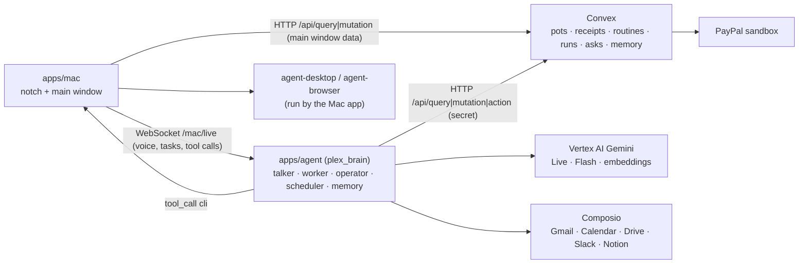

# Plex for Mac: system design and contracts

Plex for Mac is a personal agent for money and errands. It has two faces:

- **The notch** (the island): hold **fn + control** and talk, or hover the notch and type. Tasks, approvals,
  questions and hand-offs show up here as cards.
- **The main window**: Today, Needs you, Routines, Activity, Money, Memory, Connections, Settings.

It's built from Slice for Mac (`~/Desktop/slice-ai/apps/mac` and `apps/agent/slice_mac`). The taste and Qloo parts
are gone; money, routines, memory and fast computer use are new.

This file is the contract between the three parts. Change it before changing an interface.

```
apps/mac          Swift 6 / SwiftUI notch app + main window (XcodeGen project "PlexMac", product "Plex")
apps/agent        Python brain (FastAPI + Google ADK, Gemini on Vertex AI): talker, worker, operator,
                  routines scheduler, memory. Package `plex_brain`, server on :8790
packages/backend  Convex: the source of truth for pots, receipts, approvals, routines, runs, asks, memory,
                  bills, subscriptions, activity
```



## 1. Principles the code keeps

1. **No money moves without a Receipt.** The brain never calls PayPal. It asks Convex (`agentMoney:*`), which runs
   the policy engine, writes the receipt and calls PayPal.
2. **Limits are enforced in code.** The policy decision comes from `convex/lib/policy.ts evaluate()`. The model
   only fills in amount, payee and why.
3. **Hand-offs are first-class.** When the agent needs a person, it creates an **ask** and waits. Kinds of ask:
   an approval (money or an irreversible step), a question, a takeover (do this on screen, then press Continue)
   or a login. The ask shows in the notch and in the main window's Needs you list. Answering either one
   resolves it, and the agent carries on.
4. **Routines are compiled once and checked every time.** The model turns the user's sentence into a structured
   `spec` (trigger, conditions, steps, guardrails). The user sees "When / If / Then" and saves it. At run time
   the worker follows the steps. Money steps still go through the policy engine.
5. **Memory is explicit and editable.** Every memory has its text, a kind, where it came from and how often it
   was used. The user can edit, pin or forget any of them in the main window.
6. **Computer use is accessibility first.** agent-desktop reads native apps through the macOS accessibility
   tree, and agent-browser drives Chrome over CDP. Both are text, fast and exact. A screenshot loop (Gemini
   computer use) is the fallback for UIs without an accessibility tree.

## 2. Convex (packages/backend)

New tables go in a new section at the end of `schema.ts`, under `// ── Plex for Mac: agent, routines, memory`.
Money stays in the policy section.

### Tables

```ts
routines: {
  ownerId: Id<"users">,
  name: string,                       // "Pay rent when everyone's in"
  prompt: string,                     // the user's own words
  icon: string,                       // lucide-style name; the Mac maps it to an SF Symbol
  spec: {
    trigger:
      | { kind: "schedule"; cadence: "hourly" | "daily" | "weekly" | "monthly" | "once";
          time?: string /* "HH:MM" local */; days?: number[] /* 0=Sun */; dayOfMonth?: number;
          everyHours?: number; at?: number /* once, ms */ }
      | { kind: "email"; query: string /* Gmail search */; label: string /* "Email from Comcast" */ }
      | { kind: "paypal"; event: string /* "INVOICING.INVOICE.PAID" */; label: string }
      | { kind: "folder"; path: string; pattern?: string; label: string }
      | { kind: "manual" },
    conditions: { text: string; check?: string }[],      // "Food pot has money left"
    steps: { id: string; kind: "check" | "act" | "money" | "notify" | "ask" | "wait";
             title: string; detail?: string; tool?: string }[],
    guardrails: { potName?: string; maxSpendCents?: number;
                  approval: "always" | "over_limit" | "never_money" },
    summary: string,                  // one sentence: "Every Friday at 6 pm, moves half of …"
  },
  runWhere: "mac" | "cloud",          // mac: needs the screen or Mac apps; cloud: APIs only
  missed: "run_on_wake" | "skip",     // what to do if the Mac was asleep at the time
  timezone: string,                   // IANA, from the Mac
  enabled: boolean,
  nextRunAt?: number,                 // ms; only for schedule triggers
  lastRunAt?: number,
  lastStatus?: RunStatus,
  lastSummary?: string,
  createdAt: number,
}.index("by_owner", ["ownerId"]).index("by_next", ["enabled", "nextRunAt"])

routineRuns: {
  routineId: Id<"routines">, ownerId: Id<"users">,
  status: "queued" | "running" | "waiting" | "done" | "failed" | "skipped" | "cancelled",
  reason: string,                     // "Scheduled for 9:00", "Missed while your Mac slept, ran on wake", "Run now"
  startedAt: number, endedAt?: number,
  steps: { at: number; kind: "info" | "tool" | "money" | "ask" | "done" | "error"; label: string; detail?: string }[],
  summary?: string,                   // what it did, one or two sentences
  receiptIds: Id<"receipts">[],
  askId?: Id<"asks">,                 // the ask it's waiting on
}.index("by_routine", ["routineId", "startedAt"]).index("by_owner", ["ownerId", "startedAt"])

asks: {                               // the human hand-off inbox
  ownerId: Id<"users">,
  kind: "approval" | "question" | "takeover" | "login",
  title: string,                      // "Pay Comcast $84.20?"  "Sign in to Comcast in the Plex browser"
  detail?: string,
  options?: string[],                 // a question's choices
  amountCents?: number, payee?: string, ruleText?: string, potName?: string,
  approvalId?: Id<"approvals">,       // a money approval mirrors its approvals row
  source: { kind: "voice" | "task" | "routine"; label: string; runId?: Id<"routineRuns">; taskId?: string },
  status: "pending" | "answered" | "cancelled" | "expired",
  answer?: { approved?: boolean; always?: boolean; text?: string; by: "notch" | "window" | "voice" },
  createdAt: number, answeredAt?: number,
}.index("by_owner_status", ["ownerId", "status"])

memories: {
  ownerId: Id<"users">,
  kind: "fact" | "preference" | "person" | "merchant" | "habit" | "note",
  text: string,                       // plain words: "Pays rent to Sam Okafor on the 1st"
  about?: string,                     // a person's or merchant's name
  source: "said" | "learned" | "email" | "routine" | "settings",
  confidence: number,                 // 0-1
  pinned: boolean,                    // always in the agent's context
  uses: number, lastUsedAt?: number,
  embedding: number[],                // 768 dims, gemini-embedding-001 (computed by the brain)
  archived: boolean,
  createdAt: number, updatedAt: number,
}.index("by_owner", ["ownerId", "updatedAt"])
 .vectorIndex("by_embedding", { vectorField: "embedding", dimensions: 768, filterFields: ["ownerId"] })

bills: {
  ownerId, payee: string, payeeEmail?: string, category: string,   // "Utilities"
  amountCents: number, dueAt: number, status: "upcoming" | "paid" | "overdue" | "scheduled",
  autopay: boolean, source: "email" | "invoice" | "manual", note?: string,
  usualCents?: number,                // average of the last bills, to spot a spike
  receiptId?: Id<"receipts">, paidAt?: number,
}.index("by_owner_due", ["ownerId", "dueAt"])

subscriptions: {
  ownerId, merchant: string, plan: string, amountCents: number,
  cadence: "monthly" | "yearly", nextChargeAt: number,
  status: "active" | "cancelled" | "paused",
  lastUsedAt?: number,                // from Mac app usage or email, null if unknown
  previousAmountCents?: number,       // set when the price went up
  paypalSubscriptionId?: string, category: string,
}.index("by_owner", ["ownerId"])

agentActivity: {                      // Today's feed
  ownerId, at: number,
  kind: "voice" | "task" | "routine" | "money" | "memory" | "handoff" | "system",
  title: string, detail?: string,
  receiptId?: Id<"receipts">, runId?: Id<"routineRuns">, routineId?: Id<"routines">,
}.index("by_owner_time", ["ownerId", "at"])
```

`policyRule` gets one more kind: `{ kind: "auto_approve", merchant: string, upToCents: number }` ("Pay Comcast
up to $100 without asking"). Tapping **Always** on an approval adds it. `evaluate()` returns `allow` for that
merchant at or under the amount, after hard denials but before `approval_over`.

### Functions

Everything the main window reads is a **public query** that runs as the viewer (`getViewer`: the signed-in user, or
Adi). The brain calls **public functions that take `secret: string`**, checked against `PLEX_AGENT_SECRET` in the
Convex env. They act for Adi, since the brain runs in guest mode too. Put the check in `convex/lib/agentAuth.ts`
(`requireAgent(secret)`).

For the main window (no secret):

| Function | Args | Returns |
|---|---|---|
| `agent:today` | `{}` | `{ user: {name, paused}, needsYou: Ask[], upcoming: {bills: Bill[], routines: {_id,name,icon,nextRunAt,summary}[]}, recent: Activity[] (20), pots: Pot[] (name, icon, color, balanceCents, spentMonthCents, monthlyBudgetCents, rulesText), totals: {spentMonthCents, savedMonthCents, billsDueCents} }` |
| `agent:activity` | `{ limit?: number }` | `Activity[]`, newest first |
| `asks:pending` | `{}` | `Ask[]`, newest first |
| `asks:answer` | `{ askId, approved?, always?, text?, by }` | `null`. Mirrors onto `approvals` (and adds an `auto_approve` rule on `always`) |
| `routines:list` | `{}` | `Routine[]`, each with `lastRun?: {status, summary, startedAt}` |
| `routines:get` | `{ routineId }` | `{ routine, runs: Run[] (last 20) }` |
| `routines:save` | `{ name, prompt, icon, spec, runWhere, missed, timezone }` | `Id<"routines">`. Computes `nextRunAt` |
| `routines:setEnabled` | `{ routineId, enabled }` | `null`. Recomputes `nextRunAt` |
| `routines:remove` | `{ routineId }` | `null` |
| `routines:runNow` | `{ routineId }` | `Id<"routineRuns">`: a `queued` run the brain picks up |
| `memory:list` | `{ kind?, q? }` | `Memory[]` without `embedding`, pinned first, then newest |
| `memory:update` | `{ memoryId, text?, pinned?, kind? }` | `null`. A text change clears the embedding (`[]`) and the brain re-embeds it |
| `memory:forget` | `{ memoryId }` | `null` (`archived: true`) |
| `bills:list` | `{}` | `Bill[]` by due date |
| `subscriptions:list` | `{}` | `Subscription[]` |
| `pots:list`, `receipts:list`, `pots:pendingApprovals` | existing | existing |

For the brain (each takes `secret`):

| Function | Kind | Args → returns |
|---|---|---|
| `routines:due` | query | `{ secret, now }` → `{ due: Routine[] (enabled, nextRunAt <= now), queued: Run[] (status queued) }` |
| `routines:startRun` | mutation | `{ secret, routineId, reason, runId? }` → `runId` (creates or moves `queued` to `running`; advances `nextRunAt`) |
| `routines:skipRun` | mutation | `{ secret, routineId, reason }` → `runId` (status `skipped`; advances `nextRunAt`) |
| `routines:logStep` | mutation | `{ secret, runId, kind, label, detail? }` → `null` |
| `routines:finishRun` | mutation | `{ secret, runId, status, summary }` → `null` (updates the routine's last*, writes activity) |
| `routines:context` | query | `{ secret, routineId }` → `{ routine, recentRuns: Run[] (5) }` |
| `routines:saveFromBrain` | mutation | same as `routines:save` plus `secret` (voice: "do this every Friday") |
| `asks:create` | mutation | `{ secret, kind, title, detail?, options?, amountCents?, payee?, ruleText?, potName?, approvalId?, source }` → `askId` |
| `asks:get` | query | `{ secret, askId }` → `Ask` (the brain polls this about every 1.5 s while it waits) |
| `asks:cancel` | mutation | `{ secret, askId }` → `null` |
| `memory:insert` | mutation | `{ secret, kind, text, about?, source, confidence, embedding, pinned? }` → `memoryId` |
| `memory:patch` | mutation | `{ secret, memoryId, text?, embedding?, confidence?, touch? }` → `null` (`touch` bumps uses/lastUsedAt) |
| `memory:search` | action | `{ secret, embedding, limit? }` → `{ _id, kind, text, about, source, pinned, score }[]` (vector search filtered by owner, archived dropped) |
| `memory:core` | query | `{ secret }` → pinned plus the most used memories (12), and those with an empty embedding (`needsEmbedding`) |
| `agent:log` | mutation | `{ secret, kind, title, detail?, receiptId?, runId?, routineId? }` → `null` |
| `agent:snapshot` | query | `{ secret }` → compact JSON for the talker's instruction: the user's name, pots with limits and rules, bills due in 14 days, subscriptions, pending asks |
| `agentMoney:check` | query | `{ secret, potName, amountCents, payee, category? }` → `{ outcome: "allow" \| "needs_approval" \| "deny", ruleText, potId }` |
| `agentMoney:pay` | action | `{ secret, kind: "bill" \| "send" \| "purchase", potName, amountCents, payee, payeeEmail?, why, category?, billId?, approvalAskId? }` → `{ ok, receiptId?, outcome, ruleText, paypalId?, error? }`. Runs the policy. On `needs_approval` without an approved `approvalAskId` it creates the `approvals` row and the mirroring ask, and returns `{ ok: false, outcome: "needs_approval", askId }`. On allow, or with an approved ask, it sends a PayPal Payout from the Plex sandbox account to `payeeEmail` (else to `PAYPAL_DEMO_PAYEE_EMAIL`), writes the receipt (`rule.source` "policy" or "approval", `why` in the user's words), updates the pot and the bill, and logs activity |
| `agentMoney:request` | action | `{ secret, from: {name, email}[], items: {name, amountCents}[] per person, why, note? }` → `{ ok, splitId?, invoiceIds[], receiptIds[] }` (PayPal invoices, one per person; a split row) |
| `agentMoney:cancelSubscription` | action | `{ secret, subscriptionId, why }` → `{ ok, receiptId?, error? }` (PayPal Subscriptions cancel when `paypalSubscriptionId` is real, otherwise marks it cancelled with a system receipt) |
| `agentMoney:recent` | query | `{ secret, days? }` → receipts and transactions, compact |

When PayPal isn't configured, money actions still write receipts with `paypal` ids prefixed `SIM-` and say so.

### Seed

`seed:run` adds to Adi's world:
- 6 bills: rent to Sam Okafor ($1,850, the 1st), Comcast ($84.20, normally $79), Pacific Power (a spike: $212,
  usual $96), a phone bill, renter's insurance, a gym. Mixed `autopay`.
- 7 subscriptions: streaming, music, cloud storage (price went up from $2.99 to $4.99), a design tool unused for 74
  days, news, a meal kit, a VPN.
- 5 routines across trigger kinds, each with 2-4 past runs: pay rent when all roommates have paid; a weekly money
  check-in on Fridays; a utility bill guard; a subscription price watch; invoice-paid pass-through to a contractor.
- 14 memories: landlord, roommates and their emails, the contractor's 30% share, "prefers to approve anything over
  $100", "uses Chase for checking" and so on.
- 1 pending question ask and 1 pending money approval, so Needs you isn't empty.
- About 25 activity rows over the past week.

## 3. Brain (apps/agent, package `plex_brain`)

Forked from `slice_mac`. Run it with `uv run uvicorn server:app --port 8790 --reload` from `apps/agent` (or `pnpm --filter @plex/agent dev`).
`.env` (git-ignored): `GOOGLE_GENAI_USE_VERTEXAI=true`, `GOOGLE_CLOUD_PROJECT`, `GOOGLE_CLOUD_LOCATION=global`,
`GOOGLE_APPLICATION_CREDENTIALS` (`apps/agent/.secrets/*.json`), `CONVEX_URL`, `PLEX_AGENT_SECRET`,
`COMPOSIO_MAC_API_KEY`, `MAC_CLIENT_TOKEN` (hosted only).

Models (Vertex): talker `gemini-3.8-live` in `us-central1` (voice Aoede); worker `gemini-3.8-flash`, low thinking,
falling back to 3.6/3.7 Flash; operator `gemini-3.8-flash` with function tools over the CLI, and Gemini computer use
as the fallback; embeddings `gemini-embedding-001` at 768 dims; routine compiler `gemini-3.8-flash` with structured
output.

### Modules

```
server.py                 FastAPI app: /mac router, /health, starts the scheduler on startup
plex_brain/
  routes.py               WS /mac/live and HTTP routes (below)
  talker.py               Gemini Live agent: Plex's voice; quick tools + start_task/continue_task
  tools.py                the talker's tools
  tasks.py                TaskManager (from Slice) + NEEDS_TAKEOVER; every pause also creates a Convex ask
  worker.py               the worker agent and its tool list
  convex.py               async Convex HTTP client: query/mutation/action, adds `secret`
  money.py                worker tools over agentMoney:* (pay, request, cancel, check, recent, overview)
  memory.py               embed(), remember(), recall(), core_memories(), reflect(task transcript) -> memories
  routines.py             compile(prompt) -> spec; Scheduler (loop every 30 s, catch-up on Mac hello/wake);
                          run(routine) = a quiet Task with a Convex run record
  operator.py             computer use: desktop and browser tools over the Mac's `cli` tool, hand-off tools,
                          and the screenshot fallback (Slice's computer.py)
  accounts.py             Composio (Slice's accounts.py, money-relevant catalog: Gmail, Calendar, Drive, Sheets,
                          Slack, Notion, …)
  mac_tools.py            Calendar, Contacts, Reminders, Notes, Messages, files on the Mac (from Slice)
  connection.py, bridge.py  from Slice
```

### HTTP routes

| Route | Body → result |
|---|---|
| `GET /mac/health` | `{ ok, model, convex: bool, composio: bool }` |
| `POST /mac/routines/compile` | `{ prompt, timezone }` → `{ name, icon, spec, runWhere, missed, questions: string[] }` (`questions` is what's unclear, at most 2) |
| `POST /mac/routines/run` | `{ routineId }` → `{ runId }` (now, in the brain) |
| `GET /mac/accounts?user=` | Composio catalog with connection states (Slice's shape) |
| `POST /mac/accounts/connect` · `/disconnect` | Slice's shape |
| `GET /mac/tools/status` | `{ agentDesktop: {installed, version, accessibility}, agentBrowser: {installed, version} }` (asks the Mac over the bridge when connected) |

### Scheduler

- A loop every 30 s calls `routines:due` and `routines:context`.
- For each due routine:
  - `runWhere: "cloud"` runs in the brain.
  - `runWhere: "mac"` runs only while a Mac is connected. With no Mac, it waits.
  - If the run is more than 10 minutes late (the Mac or the brain was asleep): with `missed: "run_on_wake"` it
    runs, with the reason "Missed at 9:00 while your Mac slept, ran on wake". With `"skip"` it calls `skipRun`.
- On `hello` and on `{"type":"wake"}` from the Mac, the scheduler checks at once.
- `queued` runs (Run now from the window) start immediately.
- Email, PayPal and folder triggers: the scheduler polls Gmail through Composio every 5 min for `query`
  (`newer_than:1d`, deduped by message id in memory). PayPal events arrive through Convex webhooks, which queue a
  run. Folder triggers are watched by the Mac (`{"type":"folder_event"}`).
- A run is a quiet `Task` whose goal is the routine's prompt, spec, recent runs and the trigger payload.
  - Every worker step is mirrored to `routines:logStep`.
  - Every pause creates an ask, and the run status becomes `waiting`.
  - The run ends with `finishRun`.

### Hand-offs

`TaskManager.ask`, `confirm_action` and the new `takeover(task, title, detail, kind)` each:
1. create a Convex ask (`asks:create`);
2. send the `task` frame to the Mac (the notch card);
3. wait for whichever answer comes first, from a WebSocket `task_reply` / `task_confirm` / `task_continue` or from
   polling `asks:get` (answered in the main window or on the web).

Answering one cancels the other. A money approval is the `approvals` row plus its ask. `agentMoney:pay` returns
`needs_approval` with an `askId`. The money tool waits on that ask, then calls `pay` again with `approvalAskId`.

### Operator (computer use)

The worker calls `operate(job, surface="auto"|"desktop"|"browser")`. The operator is its own LLM loop with these
tools:

- Desktop: `desktop_apps()`, `desktop_snapshot(app, root?)`, `desktop_find(app, query)`, `desktop_click(ref)`,
  `desktop_type(ref, text)`, `desktop_set_value(ref, value)`, `desktop_press(keys, app?)`, `desktop_launch(app)`,
  `desktop_scroll(ref, direction)`, `desktop_wait(ms)`
- Browser (`--session plex --profile ~/Library/Application Support/Plex/browser --headed`): `browser_open(url)`,
  `browser_snapshot()`, `browser_click(ref)`, `browser_fill(ref, text)`, `browser_type(ref, text)`,
  `browser_press(key)`, `browser_get_text(ref?)`, `browser_wait(ms|text)`, `browser_back()`
- People and fallback: `ask_permission(question)`, `ask_user(question)`,
  `hand_over(title, detail, kind="takeover"|"login")`, `look_at_screen(question)` (screenshot plus Gemini vision,
  when the accessibility tree is empty)

Each CLI call goes to the Mac as `tool_call {name: "cli", args: {bin, args: [..], timeout_ms}}`, and the Mac runs it.
The operator never types passwords or card numbers and never solves CAPTCHAs: it calls `hand_over(kind="login")`.
The user signs in once in Plex's own browser profile, which keeps the session.

### Memory

- **Read:**
  - On connect, `memory:core` goes into the talker's and the worker's instructions as "What you know about them".
  - The worker also has `recall(query)`, which runs a vector search and bumps `uses`.
- **Write:**
  - `remember(text, kind, about?)` from the talker or the worker (said by the user, so `source` is "said").
  - After each finished task or run, `reflect()` asks Flash for at most 3 new durable facts as structured output.
    Each one is checked against the existing memories (cosine above 0.92 means update, not insert).
- The brain re-embeds memories with an empty embedding (edited in the window) on its next loop.

## 4. WebSocket protocol (/mac/live)

Slice's protocol, minus the taste frames (`profile`, `noticed`, `feedback`, `learn_answer`, `picks`, `nudge`,
`settings`), plus the following.

Mac → brain:

| Frame | Meaning |
|---|---|
| `{"type":"hello","user_id","timezone","name"}` | First frame |
| `{"type":"task_continue","id"}` | The takeover card's "I've done it" |
| `{"type":"ask_answer","ask_id","approved"?, "always"?, "text"?}` | An ask answered in the notch that has no live task (a routine's ask) |
| `{"type":"wake"}` | The Mac woke from sleep or the lid opened (`NSWorkspace.didWakeNotification`) |
| `{"type":"folder_event","path","file"}` | A file appeared in a watched folder |

Brain → Mac:

| Frame | Meaning |
|---|---|
| `{"type":"task","task":{…, "status":"needs_takeover", "takeover":{title,detail,kind,url?}, "approval":{amountCents,payee,ruleText,potName,askId}?, "receipt":{…}?, "routine":{id,name}?}}` | The task frame gains `takeover`, `approval` (money approval card: Allow / Deny / Always), `receipt` (a receipt to slide in when money moved) and `routine` (a run's quiet card) |
| `{"type":"receipt","receipt":{id,amountCents,payee,why,ruleText,state,kind}}` | Money moved (talker or worker): the notch shows the receipt card for 6 s |
| `{"type":"asks_changed"}` | Refresh Needs you (the window and the notch badge) |

Mac tools (`tool_call` names): Slice's list (`frontmost_app`, `open_url`, `open_app`, `calendar_*`, `reminders_*`,
`notes_*`, `contacts_search`, `messages_send`, `mail_draft`, `save_file`, `screenshot`, `computer`, …) without the
lens, plus:

| Tool | Args → result |
|---|---|
| `cli` | `{ bin: "agent-desktop" \| "agent-browser", args: string[], timeout_ms? }` → `{ code, stdout, stderr }` (only these two binaries; found once from the login shell's PATH) |
| `app_usage` | `{ apps: string[] }` → `{ usage: {app, lastUsedAt?}[] }` (from `NSWorkspace` and Spotlight's last-used date, `kMDItemLastUsedDate`) |
| `read_file` | `{ path }` → `{ text?, image? (base64), mime }` (a dropped receipt or bill) |

The drop zone: dropping a file on the notch sends `{"type":"text","text":"[Dropped file: /path]"}` plus the file. The
talker starts a task, for example "split this receipt".

## 5. Mac app (apps/mac)

- XcodeGen project `PlexMac`, bundle id `ai.plex.mac`, product name **Plex**, `LSUIElement` (menu bar + notch).
  The main window gives the app a Dock icon while it's open (`NSApp.setActivationPolicy(.regular)`), and the app
  goes back to `.accessory` when it closes.
- **Island:** Slice's black glass, merged with the notch. Plex green (`green-400` #3ecf8e) is for money that moved,
  steel blue for money that's held or waiting. Cards:
  - task progress;
  - money approval (amount large, payee, pot, the rule that asked; **Allow** in brand green, **Deny**, **Always**);
  - question (choices or typed answer);
  - takeover ("Plex needs you": what to do, **I've done it**, **Cancel**);
  - receipt (amount, payee, why, rule; foil edge);
  - routine ran (a pill under the notch);
  - file drop.
- **Main window** (`NavigationSplitView`, light, canvas `#f6f8f7`, the Plex tokens in `UI/PlexTheme.swift`):
  - **Today:** greeting and status, Needs you, coming up (bills and next routine runs), recent activity, pots.
  - **Needs you:** every pending ask, answerable here.
  - **Routines:** list, detail as a When / If / Then flow with run history, and New routine (describe it,
    compile, review, save). Run now, on/off.
  - **Activity:** every run, task and receipt.
  - **Money:** pots with rules, bills, subscriptions, recent receipts. "Open the Ledger" goes to the web app.
  - **Memory:** search, grouped by kind, edit, pin, forget, with source and use count.
  - **Connections:** Composio apps, Mac permissions, computer-use tools status.
  - **Settings:** brain address, voice, talk keys, Pause all agent spending.
- Data: `ConvexClient` (HTTP `POST {CONVEX_URL}/api/query` and `/api/mutation`, polling every 3 s while the window
  is visible, at once after a mutation and on `asks_changed`).
- Defaults: brain `ws://127.0.0.1:8790/mac/live`, Convex `http://127.0.0.1:3210`. Both can be changed in Settings.
